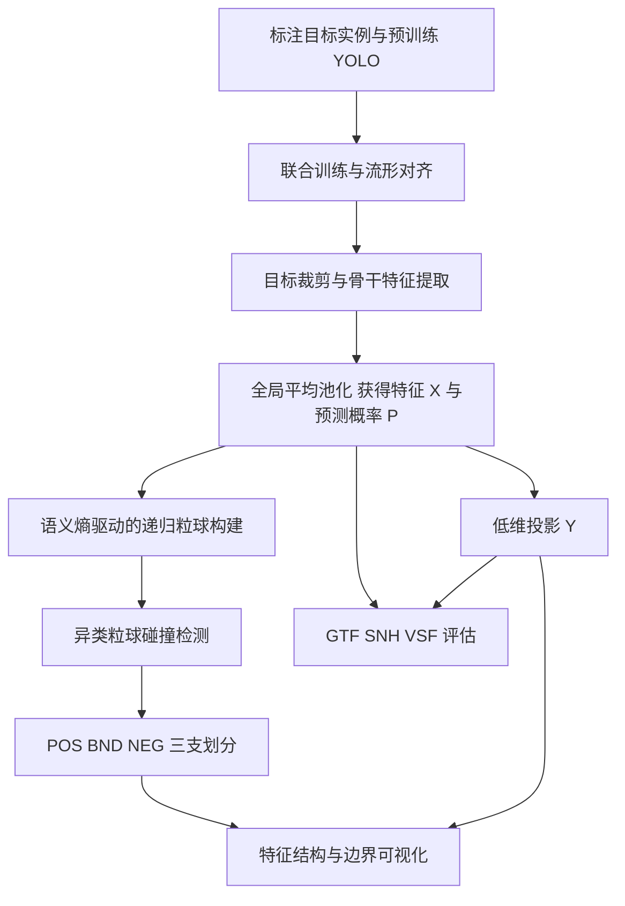
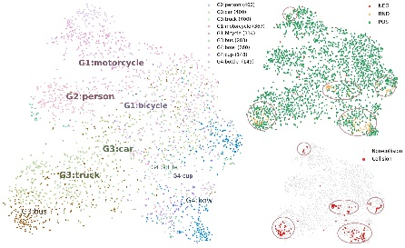
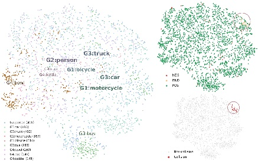
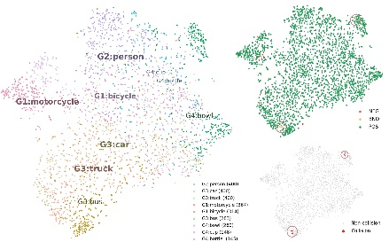

# MC3WD-SEGBC

**一种用于 YOLO 模型的高维特征评估框架**  
*A High-Dimensional Feature Evaluation Framework for YOLO*

MC3WD-SEGBC（Manifold Collision 3WD Semantic-Entropy GBC）结合语义熵驱动的粒球计算与异类流形碰撞三支决策，用于分析 YOLO 高维实例特征的语义组织、类别边界和低维可视化质量。框架同时引入视觉–语义保真度（VSF），从几何结构保持与语义邻域一致性两个方面评估降维结果。

当前内容包包含方法文档、论文报告的实验数据和原始配图；运行代码、模型权重与安装步骤尚待补充。数值来自论文 v2，未在本内容包中重新运行实验。

## 研究动机

检测精度和二维散点图分别反映模型性能与特征分布的一部分信息。仅观察 t-SNE、UMAP 等投影的视觉分离效果，难以判断高维空间中的邻域是否被保留，也难以识别长尾分布、语义纠缠和流形各向异性造成的边界冲突。

本框架将高维空间的粒球覆盖与异类碰撞作为边界分析依据，并用独立的投影质量指标检查低维表示。

## 核心方法

- **语义熵驱动粒化**：利用样本预测概率的平均分布计算粒球语义熵，结合二元分裂与信息增益约束，构建语义一致的局部表示。
- **鲁棒粒球包络**：使用距离的 95% 分位数定义有效覆盖半径，减轻长尾末端和离群样本对球体半径的影响。
- **异类流形碰撞三支划分**：依据不同主导语义粒球的碰撞和样本实际覆盖关系，将样本划为正域 POS、边界域 BND 和负域 NEG。
- **视觉–语义保真度 VSF**：结合几何拓扑保真度 GTF 与语义邻域一致性 SNH，并支持多邻域尺度的积分评价。

## 处理流程



原稿包含联合训练步骤，但尚未给出复合损失函数的完整定义，相关复现信息见[复现说明](docs/reproducibility.md)。

## 主要实验结果

实验采用 COCO 中 9 个类别、共 16,873 个样本，检测模型覆盖 YOLO11、YOLOv12 和 YOLO26 的 n/s/m/l/x 五种尺度。框架机制重点比较 YOLO11n、YOLO11x 与 YOLO26x。

| 模型 | Silhouette ↑ | VSF ↑ | GTF ↑ | SNH ↑ | BND Rate/% ↓ |
| --- | --- | --- | --- | --- | --- |
| YOLO11n | 0.425 | 0.829 | 0.735 | 0.916 | 10.05 |
| YOLO11x | 0.597 | 0.845 | 0.769 | 0.921 | 1.82 |
| YOLO26x | 0.654 | 0.865 | 0.769 | 0.961 | 0.30 |

在这三组实验中，YOLO26x 的 VSF、SNH 和轮廓系数最高，BND Rate 最低；其 GTF 与 YOLO11x 相同。结果反映该实验设置下更好的语义邻域一致性和较少的异类边界冲突。完整数据及评估口径见[实验说明](docs/experiments.md)。

### 特征分布与三支边界

下图来自原稿图 1。每幅图同时展示类别投影、三支区域以及碰撞点。

| YOLO11n | YOLO11x | YOLO26x |
| --- | --- | --- |
|  |  |  |

## 文档与数据

- [方法、公式与 3 个算法](docs/method.md)
- [实验设置、5 张完整数据表与消融配图](docs/experiments.md)
- [复现信息与待补充内容](docs/reproducibility.md)
- [论文信息与 26 条参考文献](docs/references.md)
- [CSV 实验数据](results/README.md)
- [原始图片与图号对应关系](assets/figures/README.md)

```text
.
├── README.md
├── docs/
│   ├── method.md
│   ├── experiments.md
│   ├── reproducibility.md
│   └── references.md
├── results/
│   ├── README.md
│   └── table*.csv
└── assets/figures/
    ├── README.md
    └── image1.jpeg … image19.jpeg
```

## 后续方向

将评估范围扩展至其他检测架构，以及分割、跟踪和多模态任务；进一步验证不同数据分布和投影设置下的结构保持与边界分析效果。

## 作者

吴骏一、王维政、蒋毅、沈姿彤、石孝安、田立勤。作者单位、基金项目与通信信息见[论文信息](docs/references.md)。正式引用信息和开源许可证将在确定后补充。
