# 实验设置与结果

[返回首页](../README.md) · [方法](method.md) · [复现说明](reproducibility.md)

以下数值按原稿表 1–5 提取；合并单元格中的模型和阶段名称已补全。原稿未提供原始预测与运行日志，本内容包未重新训练或计算这些指标。

## 数据与模型

- 数据来源：COCO 中 9 个类别，共 16,873 个样本。
- 单独观察类别：person。
- 外观相近组：bicycle / motorcycle；car / bus / truck；bottle / cup / bowl。
- 检测模型：YOLO11、YOLOv12、YOLO26，每种包含 n、s、m、l、x 五个尺度。
- 机制验证模型：YOLO11n、YOLO11x、YOLO26x。
- 特征提取：按标注目标裁剪，提取目标层局部特征并进行全局平均池化。

## 硬件与训练设置

| 项目 | 原稿报告值 |
| --- | --- |
| CPU | Intel Core i5-12600K |
| GPU | NVIDIA GeForce RTX 4070 Ti |
| 操作系统 | Windows 11 |
| CUDA | 11.8 |
| Python | 3.13 |
| 可视化渲染 | DataMapPlot |
| 优化器 | Adam |
| Batch size | 16 |
| 初始学习率 | 0.0005 |
| 权重衰减 | 0.0001 |
| 梯度裁剪阈值 | 5.0 |
| 训练轮次 | 30 |
| AMP | 启用 |
| 数据增强 | Mosaic |
| 输入图像大小 | 640 |
| 目标裁剪大小 | 224 |
| 工作线程数 | 4 |
| 验证集比例 | 0.1 |
| 骨干网络 | 训练期间冻结 |

## 表 1 检测精度

全部数值单位为 %。9 个类别列沿用原表“mAP/%”下的类别数值，具体 AP 的 IoU 口径需结合评测代码确认。

| 模型 | 尺度 | person | bicycle | motorcycle | car | bus | truck | bottle | cup | bowl | mAP50 | mAP50:95 |
| --- | --- | --- | --- | --- | --- | --- | --- | --- | --- | --- | --- | --- |
| YOLO11 | n | 52.33 | 27.61 | 44.30 | 37.50 | 64.95 | 32.28 | 31.22 | 36.26 | 39.09 | 58.23 | 40.61 |
| YOLO11 | s | 58.62 | 34.59 | 49.87 | 45.97 | 73.06 | 41.31 | 39.32 | 45.21 | 45.09 | 67.05 | 48.12 |
| YOLO11 | m | 63.04 | 41.70 | 55.19 | 51.78 | 76.85 | 46.11 | 45.50 | 50.74 | 50.39 | 71.99 | 53.48 |
| YOLO11 | l | 64.24 | 43.10 | 57.84 | 53.51 | 77.62 | 47.70 | 46.71 | 52.51 | 52.11 | 73.17 | 55.04 |
| YOLO11 | x | 65.61 | 44.92 | 58.88 | 55.39 | 80.24 | 48.96 | 49.30 | 55.54 | 53.21 | 74.85 | 56.89 |
| YOLOv12 | n | 53.00 | 28.09 | 44.29 | 38.01 | 65.18 | 32.65 | 31.98 | 36.16 | 39.62 | 58.65 | 41.00 |
| YOLOv12 | s | 59.19 | 36.39 | 51.11 | 46.42 | 73.19 | 42.36 | 40.32 | 45.41 | 45.55 | 67.81 | 48.88 |
| YOLOv12 | m | 63.18 | 41.87 | 55.42 | 51.42 | 77.88 | 46.24 | 46.14 | 51.36 | 51.00 | 72.35 | 53.83 |
| YOLOv12 | l | 64.11 | 43.60 | 57.57 | 53.46 | 77.65 | 48.09 | 47.88 | 54.03 | 52.43 | 74.08 | 55.42 |
| YOLOv12 | x | 65.70 | 44.67 | 59.29 | 55.08 | 79.79 | 49.97 | 48.64 | 55.24 | 54.24 | 75.02 | 56.96 |
| YOLO26 | n | 51.58 | 27.74 | 43.27 | 37.01 | 64.99 | 32.74 | 30.76 | 36.00 | 38.87 | 57.74 | 40.33 |
| YOLO26 | s | 59.99 | 37.16 | 49.36 | 46.61 | 71.79 | 40.51 | 41.71 | 47.30 | 46.10 | 67.44 | 48.95 |
| YOLO26 | m | 63.75 | 40.67 | 54.78 | 52.30 | 76.36 | 44.62 | 47.49 | 54.64 | 52.15 | 72.45 | 54.08 |
| YOLO26 | l | 64.74 | 41.28 | 56.46 | 53.89 | 77.09 | 49.13 | 49.29 | 55.40 | 53.03 | 73.83 | 55.59 |
| YOLO26 | x | 66.29 | 45.16 | 57.73 | 56.12 | 78.86 | 51.00 | 52.10 | 58.19 | 54.85 | 75.91 | 57.81 |

YOLO26x 在表内取得最高整体 mAP50（75.91%）和 mAP50:95（57.81%）。各类别指标仍存在模型间差异，不宜据此推断所有类别、所有尺度上均由同一模型最优。

## 粒球与三支划分参数

表 2 的阶段名沿用原稿标识。整数参数在原表以浮点形式记录，此处保留原始数值。

| 阶段 | 参数 | 数值 |
| --- | --- | --- |
| GBC构建阶段（v3_spherical_entropy） | radius_percentile | 95.0 |
| GBC构建阶段（v3_spherical_entropy） | entropy_log_base | 2.0 |
| GBC构建阶段（v3_spherical_entropy） | max_split_depth | 12.0 |
| GBC构建阶段（v3_spherical_entropy） | min_entropy_gain | 0.003 |
| GBC构建阶段（v3_spherical_entropy） | split_k | 2.0 |
| GBC构建阶段（v3_spherical_entropy） | split_min_child | 12.0 |
| 3WD阶段（v3_spherical_collision） | collision_gamma | 1.1 |

## 表 3 框架机制验证

| 模型 | Silhouette ↑ | VSF ↑ | GTF ↑ | SNH ↑ | BND Rate/% ↓ | Multi-Cover Rate/% ↓ | Coverage@Risk ↓ | FPR-95% ↓ |
| --- | --- | --- | --- | --- | --- | --- | --- | --- |
| YOLO11n | 0.425 | 0.829 | 0.735 | 0.916 | 10.05 | 92.61 | 0.021 | 6.74 |
| YOLO11x | 0.597 | 0.845 | 0.769 | 0.921 | 1.82 | 90.92 | 0.012 | 1.95 |
| YOLO26x | 0.654 | 0.865 | 0.769 | 0.961 | 0.30 | 88.47 | 0.011 | 1.15 |

其中，↑ 表示原稿评价方向为越大越好，↓ 表示越小越好。BND Rate 和 Multi-Cover Rate 的单位明确为 %；Coverage@Risk 与 FPR-95% 沿用原表数值，精确定义和单位口径尚需补充。

- **Silhouette**：衡量类内紧凑性与类间分离性。
- **GTF**：综合可信度与连续性，衡量邻域几何结构保持程度。
- **SNH**：衡量低维邻域中预测概率分布的相似程度。
- **VSF**：加权结合 GTF 与 SNH。
- **BND Rate**：被划为边界域的样本比例。
- **Multi-Cover Rate**：同时被两个及以上粒球覆盖的样本比例。
- **Coverage@Risk**：原稿描述为高风险样本中仍被归入确信区的比例；高风险集合的构造规则未给出。
- **FPR-95%**：原稿给出数值，但未提供完整评测定义和阈值确定过程。

在这三组实验中，YOLO26x 的轮廓系数、VSF、SNH 最高，GTF 与 YOLO11x 并列最高。边界率由 YOLO11n 的 10.05% 降至 YOLO26x 的 0.30%。这些结果是特定模型与数据设置下的比较，低边界率本身仍需结合语义一致性和风险指标解释。

### 图 1 特征投影与三支边界

| YOLO11n | YOLO11x | YOLO26x |
| --- | --- | --- |
|  |  |  |

原稿定性分析显示，YOLO11n 的类别混叠及碰撞更明显；YOLO11x 的边界冲突减少；YOLO26x 的局部类别聚集更清楚。配图为从 Word 提取的原始嵌入图，尺寸与清晰度沿用源文件。

## 表 4 经典降维方法对比

| 方法 | Silhouette ↑ | VSF ↑ | GTF ↑ | SNH ↑ |
| --- | --- | --- | --- | --- |
| PCA | -0.176 | 0.52 | 0.91 | 0.13 |
| UMAP | 0.082 | 0.58 | 0.95 | 0.22 |
| t-SNE | 0.183 | 0.61 | 0.97 | 0.23 |

这三种基线中，t-SNE 的轮廓系数和 VSF 最高。表中较高的 GTF 与较低的 SNH 同时出现，说明几何邻域保持与语义一致性需要分别观察。由于 SNH 使用概率余弦相似度，不能将 1−SNH 直接解释为异类邻居比例。

原稿尚未完整报告基线的特征来源、降维参数和评估尺度；将这些结果与完整框架比较时，需要先核对输入和训练流程是否一致。

### 图 2 PCA、UMAP 与 t-SNE

| PCA | UMAP | t-SNE |
| --- | --- | --- |
| 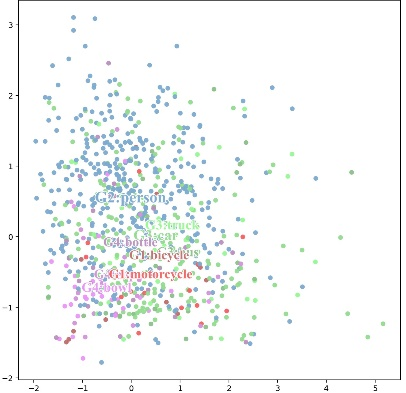 | 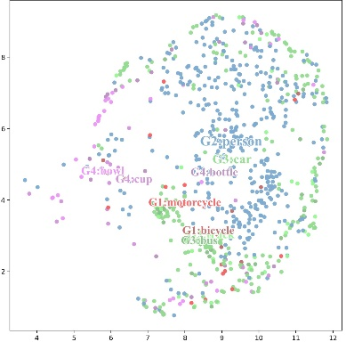 | 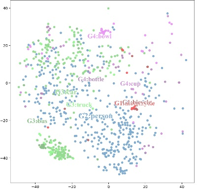 |

类别图例：

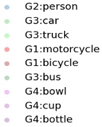

## 表 5 消融实验

| 配置 | Silhouette ↑ | VSF ↑ | GTF ↑ | SNH ↑ | BND Rate/% ↓ | Multi-Cover Rate/% ↓ | Coverage@Risk ↓ |
| --- | --- | --- | --- | --- | --- | --- | --- |
| 仅GBC | -0.138 | 0.606 | 0.972 | 0.239 | - | 98.50 | 0.150 |
| GBC+语义熵 | 0.513 | 0.803 | 0.714 | 0.921 | - | 94.12 | 0.114 |
| GBC+MC3WD | -0.051 | 0.770 | 0.735 | 0.961 | 10.05 | 96.71 | 0.071 |

“—”或“-”表示原稿未报告，不能按 0 处理。表 5 不包含完整框架的独立数据行，未将表 3 中的某一行擅自添加为同条件消融结果。

相较仅 GBC，引入语义熵后轮廓系数、VSF、SNH 均提高，Multi-Cover Rate 与 Coverage@Risk 降低；GTF 则由 0.972 降为 0.714。这说明需要同时报告几何保持与语义组织的变化，不能概括为所有指标均改善。GBC+MC3WD 行也呈现语义一致性提高及风险覆盖降低，但其 VSF 与分项之间的计算口径仍需核对。

### 图 3 消融可视化

按 Word 表格原有列顺序还原三组配置；分别展示类别分布、三支区域和碰撞高亮。

| 视图 | 仅 GBC | GBC+语义熵 | GBC+MC3WD |
| --- | --- | --- | --- |
| 类别分布 | 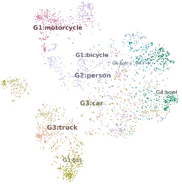 | 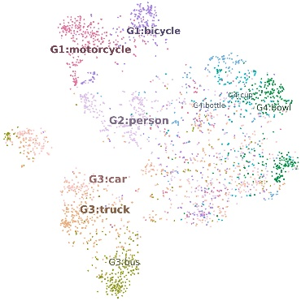 | 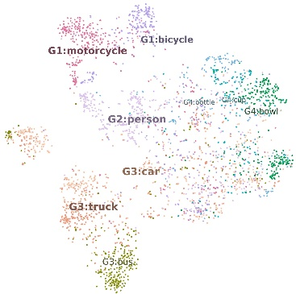 |
| 三支区域 | 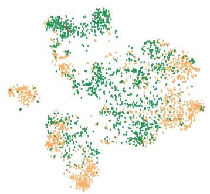 | 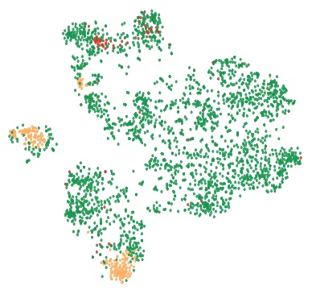 | 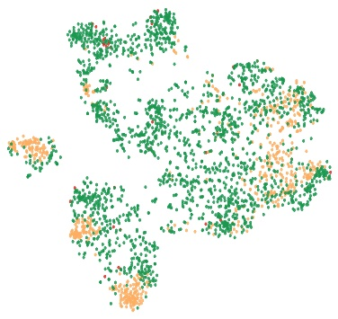 |
| 碰撞高亮 | 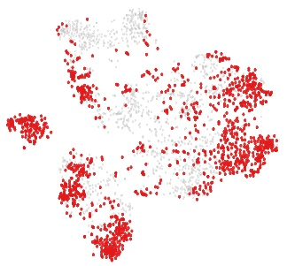 | 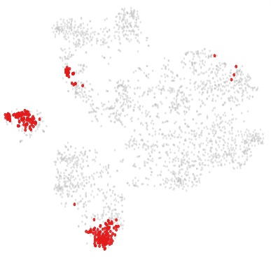 | 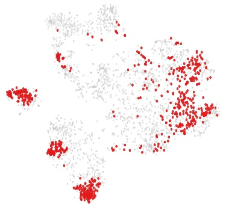 |

| 类别图例 | 三支区域图例 | 碰撞图例 |
| --- | --- | --- |
|  | 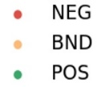 | 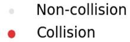 |

## 结果解读与适用范围

粒球碰撞在高维空间中确定覆盖冲突，VSF 在低维空间中检查投影质量；两者承担不同分析任务。实验支持在所选 YOLO 模型与 9 类 COCO 子集上进一步研究该方案。对其他检测架构、分割、跟踪以及多模态任务的适用性属于后续工作。

原稿未提供重复运行方差、随机种子和完整评测实现。结果应结合[复现说明](reproducibility.md)中的信息缺口解读。可机器读取的数据位于 [results](../results/README.md)。
